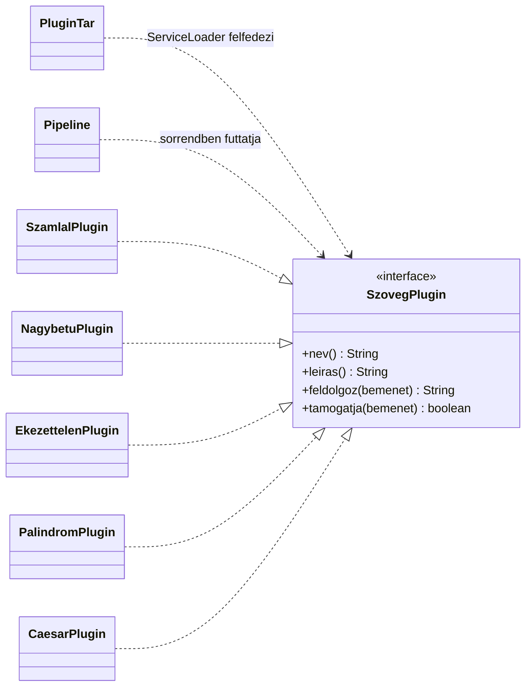

# Bővíthető szövegfeldolgozó

Java 21-es, pluginokkal bővíthető parancssori szövegfeldolgozó. A `core` modul csak a `SzovegPlugin` interfészt ismeri; a pluginokat futásidőben, a Java `ServiceLoader` segítségével fedezi fel.

## Pluginok

| Név | Művelet |
| --- | --- |
| `szamlal` | Unicode betűkből és számjegyekből álló szavak megszámolása |
| `nagybetu` | Nagybetűsítés |
| `ekezettelen` | Ékezetek eltávolítása |
| `palindrom` | Legalább kétbetűs palindrom szavak keresése, kis- és nagybetűtől, illetve ékezettől függetlenül |
| `caesar` | Caesar-kódolás három hellyel az angol ábécé betűin; az egyéb karakterek változatlanok maradnak |

## Fordítás és tesztek

A projekt Maven multi-module felépítésű. A projekt gyökérmappájában futtasd:

```bash
mvn test
```

A tesztek a `plugins` modulban vannak. A futtatható osztály neve `com.mycompany.pluginsystem.cli.PluginSystem`.

## Futtatási példák

Először fordítsd le a két modult:

```bash
mvn -pl plugins -am package
```

macOS/Linux alatt a program a két modul classpath-jával indítható. A `--plugin` értéke vesszővel elválasztott nevek listája; a sorrend számít.

```bash
printf 'Árvíztűrő tükörfúrógép' | java -cp 'core/target/classes:plugins/target/classes' \
  com.mycompany.pluginsystem.cli.PluginSystem \
  --plugin ekezettelen,nagybetu
```

Bemenet fájlból, eredmény fájlba:

```bash
java -cp 'core/target/classes:plugins/target/classes' \
  com.mycompany.pluginsystem.cli.PluginSystem \
  --plugin palindrom --input szoveg.txt --output eredmeny.txt
```

`--input` nélkül a program a standard bemenetről olvas, `--output` nélkül a standard kimenetre ír. Súgó: `--help`.

## Új plugin írása 5 lépésben

1. Hozz létre egy új, saját csomagot a `plugins/src/main/java` alatt.
2. Készíts egy paraméter nélküli konstruktorral használható osztályt, amely megvalósítja a `com.mycompany.pluginsystem.api.SzovegPlugin` interfészt.
3. Valósítsd meg a `nev()`, `leiras()` és `feldolgoz(String)` metódusokat; igény szerint írd felül a `tamogatja(String)` alapértelmezett metódust.
4. Írd be az osztály teljes nevét külön sorba a `plugins/src/main/resources/META-INF/services/com.mycompany.pluginsystem.api.SzovegPlugin` fájlba.
5. Futtasd újra a `mvn test` parancsot, majd a plugint a `--plugin` kapcsolóban a `nev()` által visszaadott névvel használd.

## Architektúra

Az implementációk függőségi nyilai a core-ban definiált interfész felé mutatnak.



Egy plugin futási hibája naplózásra kerül, az adott plugin kimarad, a lánc a legutóbbi sikeres szöveggel folytatódik. A CLI a hibát a standard hibakimenetre is kiírja.
# PluginSystem
